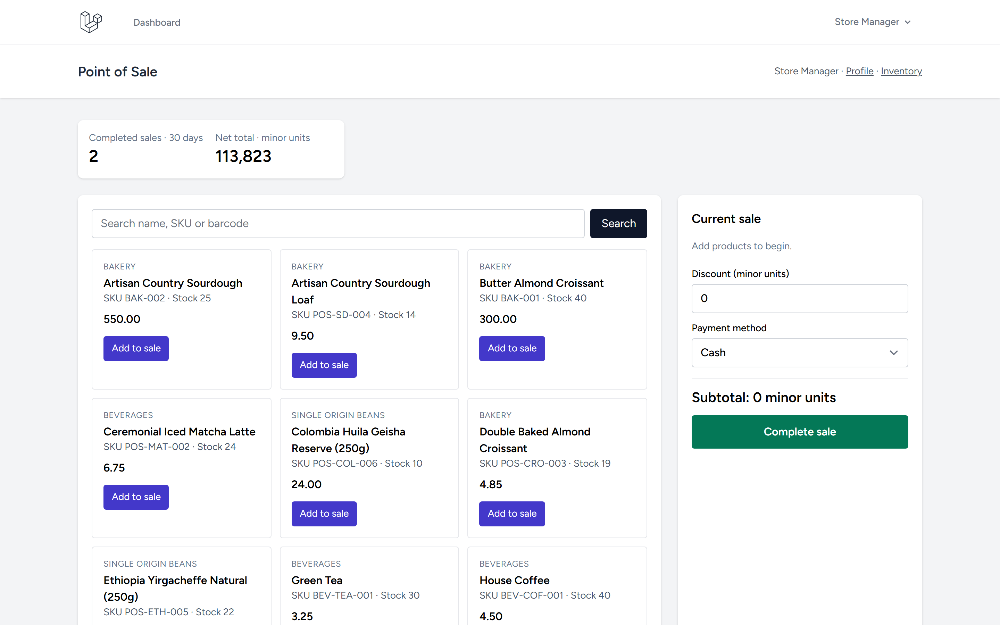
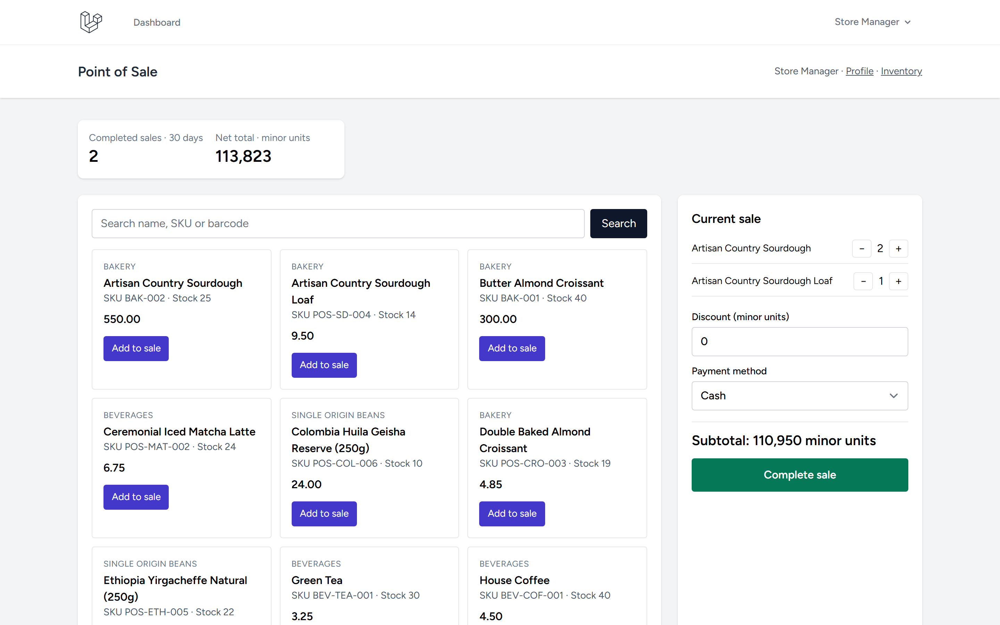
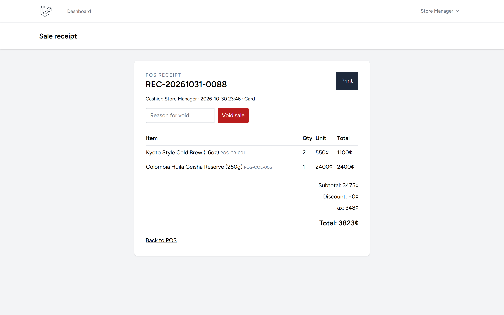
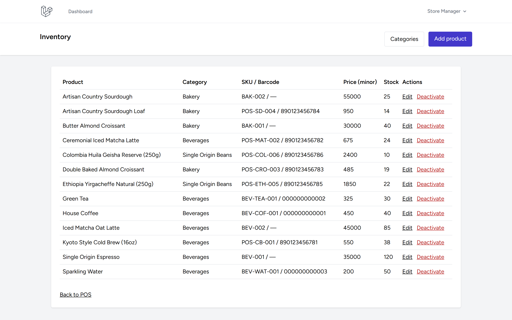

# POS Laravel

Repository: https://github.com/0xyz-exe/pos-laravel

## Screenshots

| Tampilan | Preview |
|---|---|
| **Terminal Kasir POS & Katalog Produk**<br>Antarmuka kasir penjualan langsung dengan metrik penjualan 30 hari, pencarian produk via nama/SKU/barcode, dan katalog kartu |  |
| **Kasir Aktif & Register Transaksi Penjualan**<br>Register penjualan aktif dengan rincian item belanja (+/- kuantitas), kalkulasi subtotal minor units, diskon, dan metode pembayaran |  |
| **Struk Transaksi Penjualan & Audit Void**<br>Lembar struk transaksi resmi dengan detail kasir, item breakdown, subtotal/pajak, cetak receipt, dan kontrol pembatalan void admin |  |
| **Manajemen Inventaris & Stok Produk Admin**<br>Tabel kontrol inventaris produk untuk memantau SKU, kategori, harga dalam minor units, stok riil, serta aksi kurasi produk |  |

## Features
- Login-protected cashier screen; search by product name, SKU, barcode.
- Product/category catalog with SKU, optional barcode, integer-minor-unit price, and stock.
- Transactional checkout; row locks; server-side price/stock validation; unique receipts.
- Sale snapshots, cashier access boundaries, printable receipts.
- Append-only stock-movement records for opening inventory, adjustments, and sales.
- Administrator-only product/category CRUD, inventory editing, discounts, auditable void/refund-stock workflow, and a database-backed 30-day sales report; cashier data scoped to their account.
- Breeze authentication, CSRF, request validation, throttled checkout.

## Requirements and setup
PHP 8.3+, Composer, Node.js/npm. SQLite works out of the box; PostgreSQL requires the PDO PostgreSQL extension.

```bash
composer install
cp .env.example .env
php artisan key:generate
# Configure DB_CONNECTION / DB_* in .env if using PostgreSQL.
# SQLite: create database/database.sqlite if absent.
php artisan migrate --seed
npm ci
npm run build
php artisan serve
```

Open `/register` to create a cashier account. To grant administrator access to that account, replace the example email:

```bash
php artisan tinker --execute="App\\Models\\User::where('email', 'your-email@example.com')->firstOrFail()->forceFill(['is_admin' => true])->save()"
```

No administrator credentials are seeded. Seed data contains sample categories/products only. Prices and sale totals are integer minor units; e.g. 499 represents 4.99 in a two-decimal currency. Set `POS_TAX_BASIS_POINTS` in `.env` (`100` = 1%) to configure tax; it is applied server-side. `card` records a tender method only; no card processing is implemented. Administrators can void a sale with a reason; stock is restored atomically and audited.

## Development and tests
```bash
php artisan migrate:fresh --seed
php artisan test --compact
npm run build
npm audit
```

## Security and limitations
Keep `.env` private. Admin access requires `is_admin`; do not expose self-service role assignment in production. Cashiers can view only their own sales/receipts; administrators can view all. Checkout locks products and commits sale, item snapshots, stock deductions, and movement records atomically. Product price, discount eligibility, and inventory are checked server-side. SQLite does not provide production-equivalent row-locking semantics; use PostgreSQL/MySQL for concurrent workloads and verify database-specific behavior. This is not an online payment gateway, tax-compliance package, refund-processing system, or multi-branch system. `card` is descriptive only, not evidence of payment. Configure authorized payment processing and jurisdiction-specific taxes before use.

## Dependency audit note
`npm audit --omit=dev` reports zero production vulnerabilities. Full `npm audit` reports 7 moderate/high vulnerabilities in the Tailwind CSS 3 development toolchain (`braces`, `chokidar`, `fast-glob`, `micromatch`, `postcss-nested`, `postcss-selector-parser`, `tailwindcss`). `npm audit fix` cannot resolve these without a major Tailwind CSS 4 upgrade, so the breaking migration was not forced. Reassess the toolchain before production builds.

## License
MIT (Laravel framework license applies to framework components).
